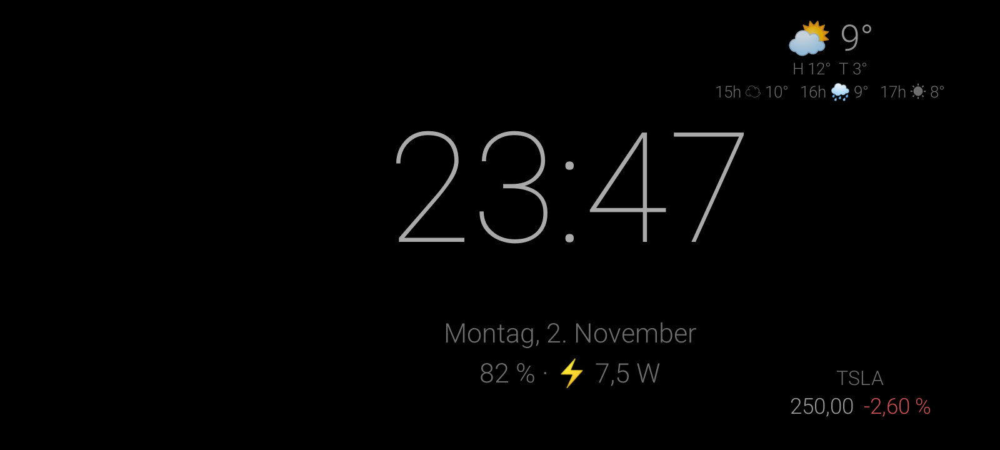
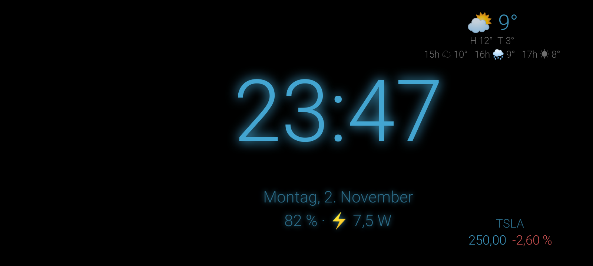
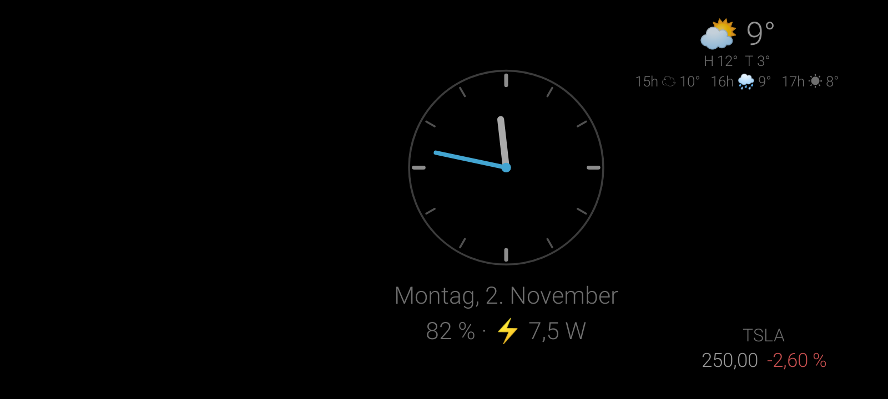
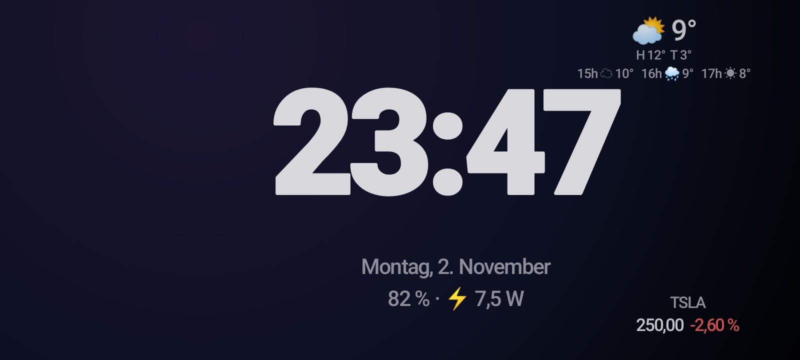
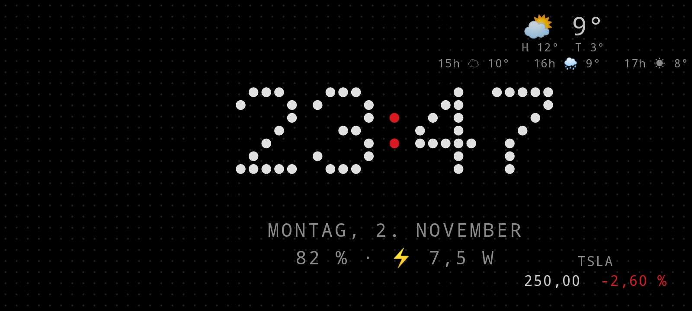
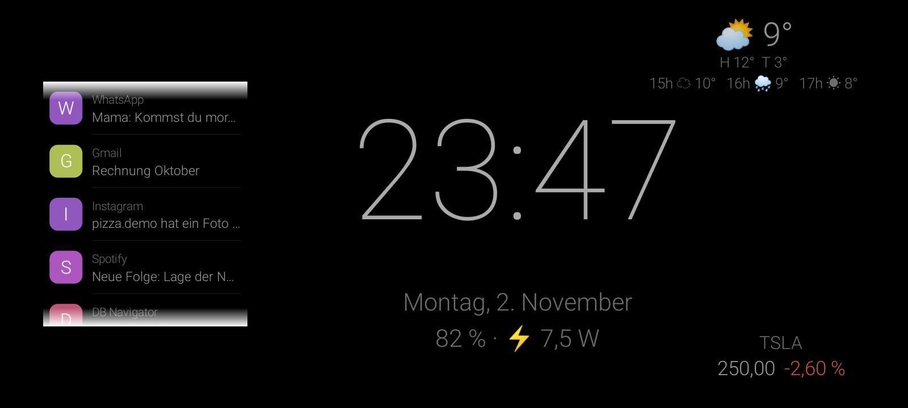
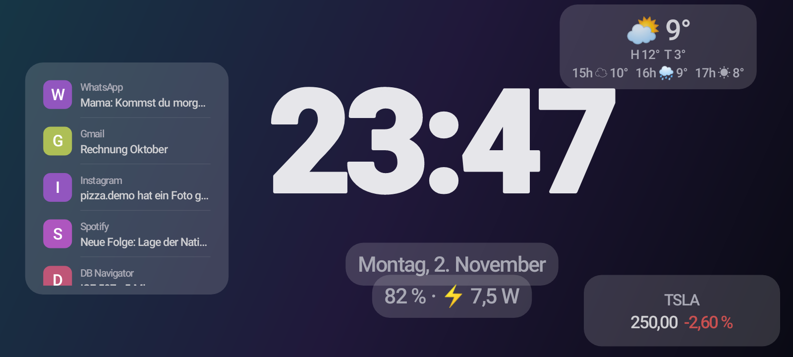
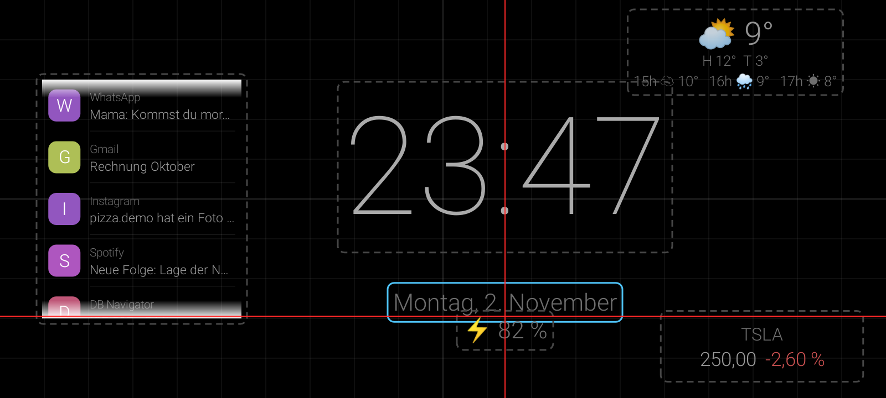

# Standby Clock 🕰️

An Android app that turns an old phone or a charging phone into an **iOS-StandBy-style bedside / desk clock** – with many themes, widgets for weather, stocks and notifications, and a layout editor.

> 🤖 **Built with AI-assisted development (vibe coding).** I designed the features, tested them and iterated on the result; most of the code was written together with an AI coding assistant.

## Screenshots

   

   

## Features

- 🎨 Many clock designs: classic, neon, analog, minimal, StandBy (night mode, glass, large), "Nothing"-style dot matrix & glyph
- 🌤️ Weather widget (Open-Meteo, no API key, city search)
- 📈 Stock ticker widget (Yahoo Finance quotes, configurable symbols)
- 🔔 Notification widget (via NotificationListener, optional)
- ✏️ Drag & drop layout editor with snapping guides
- 🔋 Opens automatically when the phone is put on a (wireless) charger, via a foreground service that survives reboots; shows battery level & charging power, keeps the screen on

## Tech stack

Kotlin · Android Views + custom `Canvas` rendering · Foreground service & BootReceiver · NotificationListenerService · Open-Meteo API · Robolectric screenshot tests

## Build & run

```bash
./gradlew testDebugUnitTest   # unit + screenshot tests (writes PNGs to screens/)
./gradlew assembleDebug
```
Requirements: JDK 17, Android SDK 35. For a signed release create your own keystore (git-ignored).

## License

[MIT](LICENSE) © 2026 Bartuan3600
